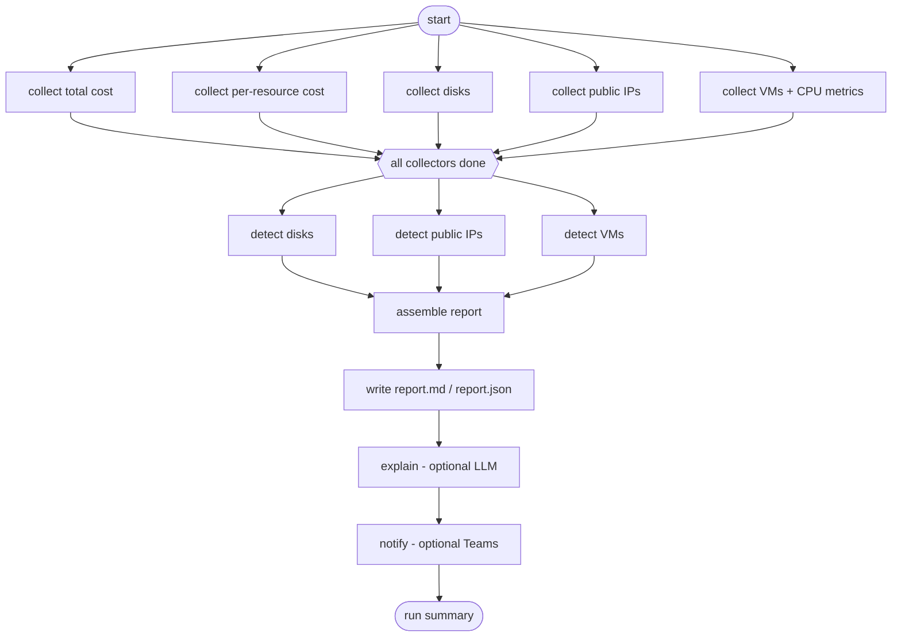

# Azure Cost Saver Agent

A **read-only** tool that scans an Azure subscription for wasted resources, attributes real costs to each finding, and writes a deterministic Markdown + JSON report. It is built as a **deterministic LangGraph workflow** that keeps working when parts of Azure fail, and says so explicitly when the report is incomplete.

It never creates, changes, stops or deletes anything in Azure.


## Why this exists

Idle disks, forgotten public IPs and oversized VMs quietly burn money. The first version of this project (a prototype where an LLM chose which tools to call, with hardcoded savings guesses) worked, but I could not trust its numbers or explain its failures. This rewrite fixes that:

- **Numbers come from billing data**, not constants. If Azure has no cost row for a resource, the report says "unknown" instead of guessing.
- **The LLM is optional and cannot touch the numbers.** It may only explain figures that already exist in the report, and any explanation containing a number not in the report is rejected.
- **Failures are visible.** A failed or timed-out call produces a *partial* report that lists exactly what is missing, instead of a clean-looking empty one.

## Quick demo (no Azure account needed)

```powershell
git clone https://github.com/aniket-devop/azure-cost-saver-agent.git
cd azure-cost-saver-agent
python -m venv .venv
.\.venv\Scripts\Activate.ps1          # Linux/macOS: source .venv/bin/activate
python -m pip install -e ".[dev]"

azure-finops demo                      # healthy run on synthetic data
azure-finops demo --scenario partial   # a collector fails -> partial report, exit code 3
azure-finops demo --scenario notify-failure
azure-finops demo --scenario llm-rejected
```

The demo runs the real workflow over in-memory synthetic data. It makes no Azure or network calls.

## Real run (read-only)

```powershell
az login
$env:AZURE_SUBSCRIPTION_ID = "<subscription-guid>"
azure-finops run --out-dir out
```

Needs the **Reader**, **Cost Management Reader** and **Monitoring Reader** roles. Output: `report.md`, `report.json`, `run_summary.json`.

Real output from a live run against my own subscription (one unattached 4 GB test disk created on purpose):

```text
Status: COMPLETE
Findings: 1 (1 confirmed, 0 potential)
Stages:
  ok         collect_total_cost
  ok         collect_resource_costs - 53 resources
  ok         collect_disks - 1 rows
  ok         collect_public_ips - 0 rows
  ok         collect_vms - 0 VMs, metrics for 0/0
  ok         detect_disks - 1 findings
  ok         detect_public_ips - 0 findings
  ok         detect_vms - 0 findings
  ok         assemble - 1 findings
  ok         write_reports - report.md, report.json
  skipped    explain - not requested
  skipped    notify - not requested
  ok         finalize - run_summary.json
Exit code: 0
```

A sample report (synthetic data, includes a partial-failure example): [`docs/sample-report/report.md`](docs/sample-report/report.md)


## What it detects

| Finding | Confidence | How it is determined | Savings figure |
|---|---|---|---|
| Unattached managed disks | **Confirmed** | Disk state read directly from Azure Resource Graph | Actual 30-day cost from Cost Management, scaled to a month; "unknown" if no cost row |
| Unattached public IPs | **Confirmed** | No IP configuration or NAT gateway attached | Same as above |
| Under-utilized VMs | **Potential** (needs human review) | Average CPU below 5% and peak below 30% over 7 days (thresholds configurable) | None: CPU is a hint, not proof |

Confirmed findings contribute to the savings total. Potential findings never do.

## Architecture



- **Fixed topology.** No node, and no LLM, decides what runs next.
- **Collectors** (the only code that calls Azure) run in parallel. **Detectors** are pure functions over collected data.
- **Reports are byte-for-byte reproducible**: the same inputs produce identical files on Windows and Linux (checked by hash in the verification script).

## Reliability design

- **Explicit partial results.** A failed, timed-out or skipped stage becomes an error in the report (status `PARTIAL`). The dependent detector is skipped, never run on "no data", so an empty result is never mistaken for "nothing wasteful".
- **Hard timeouts.** Each Azure call runs in a daemon worker thread with a time limit; a hung call is abandoned and its late result is discarded. A run-time budget (driven by an injected clock) skips remaining stages explicitly.
- **Safe parallelism.** The two Cost Management queries share a one-slot gate (it throttles per scope), and Azure Monitor calls use a bounded worker pool. One shared token cache avoids starting several slow `az` processes.
- **Failure-tolerant notifications.** A failed Teams post is recorded, never aborts the run, never alters the report, and never leaks the webhook URL.

| Exit code | Meaning |
|---|---|
| 0 | Complete report |
| 1 | Fatal: configuration or login error, or no report written |
| 3 | Report written but **partial** |
| 4 | Report complete, notification failed |
| 5 | Report partial and notification failed |

## Optional: LLM explanation and Teams

```powershell
azure-finops run --explain   # needs AZURE_OPENAI_ENDPOINT / AZURE_OPENAI_KEY, and pip install -e ".[llm]"
azure-finops run --notify    # needs TEAMS_WEBHOOK_URL
```

The explainer receives one block of text built from the finished report: no tools, no Azure clients. Its output is written to a separate `explanation.txt`; `report.md` and `report.json` never depend on it.

## Quality

- **356 automated tests**, none of which can reach a network: a suite-wide guard blocks every non-loopback connection. Azure clients and the clock are injected, so tests use fakes and a fake clock.
- Tests cover partial failures, timeouts, parallel execution (barriers that can only be passed if calls truly overlap), notification failures, LLM rules, and isolation from the legacy modules.
- **Mutation checks:** 19 deliberate bugs injected into the workflow and 35 into the reporting engine; every one is caught by the tests.
- **Ruff**, **strict mypy**, and **CI** on Ubuntu (Python 3.11, 3.12) and Windows (3.12).

```powershell
python -m pytest -q
python -m ruff check . ; python -m ruff format --check .
python -m mypy
```

## Verification status

| Area | Status |
|---|---|
| Cost collection (live Azure) | Verified |
| Unattached disk detection (live Azure) | Verified |
| Offline demo, reports, exit codes (Linux + Windows PowerShell 5.1) | Verified |
| Public IP detection | Tested with fakes; no live resource yet |
| VM CPU metrics | Tested with fakes; no live VM yet |
| `--explain` (Azure OpenAI), `--notify` (Teams) | Tested with fakes only |
| Scheduled / deployed run | Not built. Nothing is deployed to Azure |

## Project structure

```text
src/azure_finops_agent/
  collectors/   Azure calls: Resource Graph, Cost Management, Monitor (retry, pagination)
  detectors/    pure functions: disks, public IPs, VMs
  reporting/    deterministic Markdown + JSON report engine
  workflow/     LangGraph graph, timeouts, clock, optional LLM + Teams, offline demo
  cli.py        azure-finops run | demo
tests/          unit tests (fakes, fake clock, network guard)
scripts/        verification and mutation-check scripts
docs/           sample report and design notes
```

## Project history

The root-level modules (`agent.py`, `mcp_server.py`, `idle_finder.py`, ...) are the **v1 prototype**: an LLM agent calling two tools, with hardcoded waste estimates. They are kept temporarily, marked deprecated, and the new package never imports them (enforced by a test). The v1 architecture diagram in `docs/architecture.png` describes that prototype, not the current design.

## Limitations

- Findings cover three waste types; there is no remediation. The tool reports, humans decide.
- Cost data in Azure can lag by hours, so a brand-new resource may show "unknown" savings at first.
- A hung Azure call cannot be cancelled. It is abandoned and its result discarded.
- Parallel use of Azure SDK clients relies on the SDK's documented thread-safety.
- Teams payload is `{"text": ...}`; newer Workflows-based webhooks may need an Adaptive Card.

## Security

- Read-only: only reads from Azure, and the demo never touches Azure at all.
- `DefaultAzureCredential` (`az login` locally); no secrets in code or logs, and error output prints exception types only.
- Webhook URLs are never included in errors or reports.
