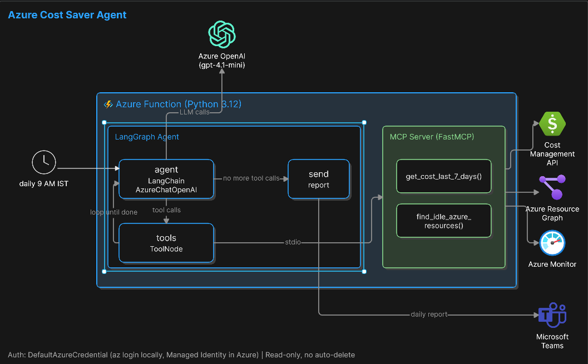
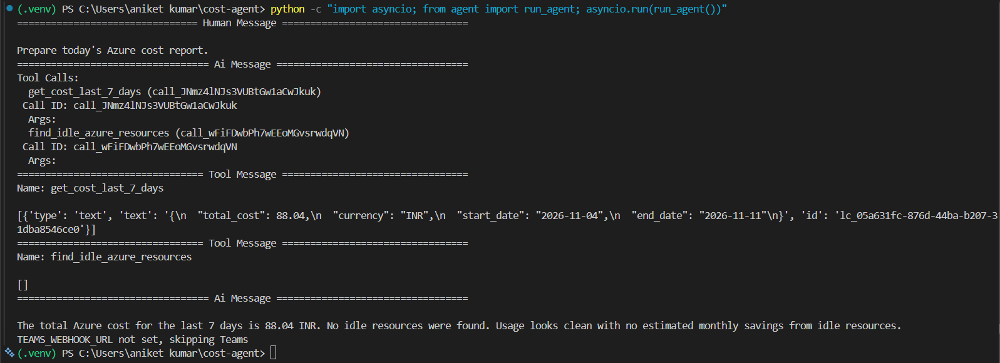
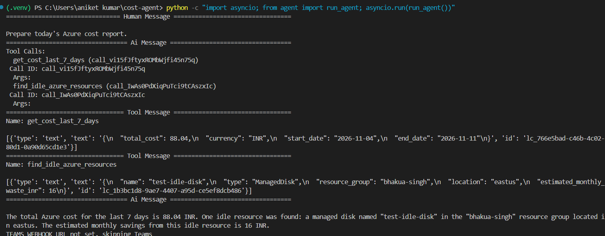
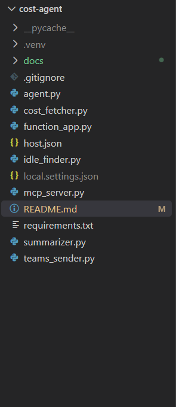

> **Status (Phase 5):** the flat modules in the repository root (`agent.py`, `cost_fetcher.py`,
> `idle_finder.py`, `mcp_server.py`, `summarizer.py`, `teams_sender.py`, `function_app.py`) are
> **deprecated** and kept only temporarily. Use the `azure_finops_agent` package:
> `azure-finops run` (read-only analysis) or `azure-finops demo` (offline). See `PHASE5_README.md`.

# Azure Cost Saver Agent

A LangGraph agent that calls MCP tools to find wasted Azure resources and writes a short cost report, optionally posted to Microsoft Teams. Read-only: it never deletes or stops anything.



## How it works

1. A LangGraph agent (Azure OpenAI gpt-4.1-mini) decides which tools to call
2. An MCP server exposes two read-only tools: `get_cost_last_7_days` and `find_idle_azure_resources`
3. The tools use Azure Cost Management, Resource Graph and Azure Monitor
4. A final node sends the report to Teams (skipped if `TEAMS_WEBHOOK_URL` is not set)

## What it detects

- Total cost for the last 7 days
- VMs with average CPU under 5% for 7 days
- Unattached managed disks
- Unattached public IPs

## Sample run

The agent calls both tools, reads the results and writes the report:



## Proof

An unattached disk (`test-idle-disk`) in the Azure Portal, which the agent found and reported:



Cost for the last 7 days in Azure Cost Management:



## Tech

Python, Azure Functions (timer trigger), Azure OpenAI, MCP (FastMCP), LangChain, LangGraph, Azure Cost Management API, Azure Resource Graph, Azure Monitor, Managed Identity

## Project structure

```
cost-agent/
  agent.py            LangGraph agent
  mcp_server.py       MCP server with 2 read-only tools
  cost_fetcher.py     Azure Cost Management query
  idle_finder.py      Resource Graph + Monitor checks
  teams_sender.py     Teams webhook sender
  function_app.py     Azure Functions timer trigger
  summarizer.py       Plain summary (v1, not used by the agent)
  host.json
  requirements.txt
  docs/               Architecture diagram and screenshots
```

## Run locally

```powershell
python -m venv .venv
.venv\Scripts\Activate.ps1
pip install -r requirements.txt
az login
$env:AZURE_SUBSCRIPTION_ID="<subscription-id>"
$env:AZURE_OPENAI_ENDPOINT="<endpoint>"
$env:AZURE_OPENAI_KEY="<key>"
python -c "import asyncio; from agent import run_agent; asyncio.run(run_agent())"
```

## Security

- `DefaultAzureCredential`: `az login` locally, Managed Identity in Azure
- Roles needed: Cost Management Reader and Reader
- No secrets in code, settings come from environment variables
- Tools are read-only

## Limitations

- Waste amounts are rough hardcoded estimates, not billing data
- Only 3 waste types and 2 tools
- Report only, no remediation
- Findings are sent to Azure OpenAI

## Status

Tested end to end locally. Deployment to Azure Functions (timer trigger with Managed Identity) and a Teams webhook are next.
